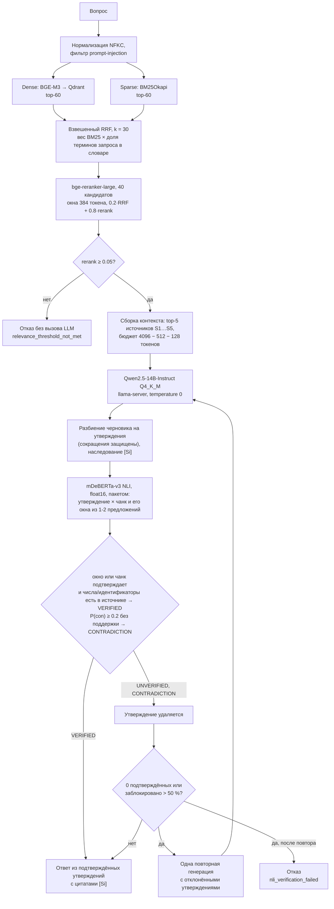

# FactRAG-NLI

[](https://github.com/EGRNEGR/FactRAG-NLI/actions/workflows/tests.yml)


**Локальная RAG-система для технической документации, которая не публикует утверждения LLM без подтверждения источником.**
Ответ генерирует Qwen2.5-14B через llama.cpp, затем каждое утверждение проверяется моделью логического вывода mDeBERTa-v3 по процитированным фрагментам: неподтверждённое удаляется, а при нехватке подтверждений вместо ответа выдаётся отказ; весь конвейер работает на одной GPU 8 ГБ без внешних API.

> **Ветка `rtx3090-linux`:** сборка под RTX 3090 (24 ГБ) и Linux с Qwen3.8-27B, внешним
> датасетом XQuAD и прогоном с отдыхом GPU (45 мин работы / 5 мин паузы). Установка и запуск:
> `bash scripts/linux/setup.sh`, затем `bash scripts/linux/run_benchmark.sh`.
> Подробности и замеры: [docs/RTX3090_LINUX.md](docs/RTX3090_LINUX.md).

- [Как это работает](#как-это-работает)
- [Ключевые возможности](#ключевые-возможности)
- [Результаты](#результаты)
- [Быстрый старт](#быстрый-старт)
- [Конфигурация](#конфигурация)
- [Структура репозитория](#структура-репозитория)
- [Ограничения](#ограничения)

## Как это работает



Посылкой для NLI служит процитированный чанк без служебного заголовка и HTML-разметки, без обрезки: пара длиннее 512 токенов получает UNVERIFIED, а не проверку по усечённому тексту, чтобы не потерять исключения и отрицания в конце фрагмента. Вместе с чанком одним пакетом оцениваются его окна из 1-2 предложений: длинный чанк смешивает подтверждающее предложение с соседними строками и условиями, и модель выдаёт на нём ложное противоречие. Одного подтверждающего источника достаточно, другой процитированный источник блокирует утверждение только явным противоречием (P(con) ≥ 0.9). Фразы об отсутствии сведений публикуются как оговорка; ответ только из оговорок становится каноническим отказом. Обоснование каждого решения и его вклад: [раздел 2 отчёта](reports/EVALUATION_REPORT.md#2-что-изменено-и-почему).

## Ключевые возможности

- **Полностью локальный контур.** Модели загружаются только из локальных файлов (`local_files_only`, `trust_remote_code=False`), LLM доступна только по loopback; документы и вопросы не покидают машину.
- **Гибридный поиск.** Dense-векторы BGE-M3 находят перефразировки, BM25 точные термины, идентификаторы и фрагменты кода; RRF объединяет кандидатов, cross-encoder переупорядочивает их, порог релевантности отсекает часть вопросов вне базы до вызова LLM.
- **NLI-верификация каждого утверждения.** Детерминированное правило (temperature 0, фиксированные пороги) пропускает к пользователю только утверждения, которые NLI-модель признала следующими из процитированных источников; отказ всегда типизирован (`relevance_threshold_not_met`, `llm_refusal`, `nli_verification_failed`).
- **Защита от ложных предпосылок.** Системный промпт запрещает принимать предпосылку вопроса за факт (premise guard); эффект измерен отдельно от NLI.
- **Документы PDF, DOCX, TXT, Markdown** со структурой разделов и таблиц, инкрементальная загрузка с дедупликацией по SHA-256, саммаризация документа с NLI-фильтром.
- **Интерфейсы:** Streamlit, FastAPI, CLI.
- **Воспроизводимая оценка:** датасет v3 из 220 стратифицированных кейсов, абляции поиска и верификации, сырые логи прогонов и генератор отчёта.

## Результаты

<!-- results:start -->
Сквозной прогон на 220 вопросах датасета v3, прод-профиль. *Standard RAG* - первый черновик той же LLM до NLI-фильтра (тот же поиск, порог релевантности и промпт), поэтому сравнение парное; после отказа NLI FactRAG-NLI один раз повторяет генерацию с отклонёнными утверждениями.

| Метрика | Standard RAG (без NLI) | FactRAG-NLI, верификатор v2 (те же черновики) | FactRAG-NLI, верификатор v1 | FactRAG-NLI, базовый прогон `20261026T1410Z_v3` |
| :--- | ---: | ---: | ---: | ---: |
| Корректный исход, все вопросы ↑ | 83.2 % (183/220; ДИ 78-88 %) | 78.6 % (173/220; ДИ 73-84 %) | 75.5 % (166/220; ДИ 69-81 %) | 56.8 % (125/220; ДИ 50-63 %) |
| Ключевые факты верны (отвечаемые) ↑ | 78.7 % (100/127; ДИ 71-85 %) | 66.9 % (85/127; ДИ 58-75 %) | 60.6 % (77/127; ДИ 52-69 %) | 27.6 % (35/127; ДИ 21-36 %) |
| Отказы на отвечаемых вопросах ↓ | 7.9 % (10/127; ДИ 4-14 %) | 18.1 % (23/127; ДИ 12-26 %) | 18.9 % (24/127; ДИ 13-27 %) | 47.2 % (60/127; ДИ 39-56 %) |
| Галлюцинации на вопросах с известной истиной ↓ | 10.8 % (10/93; ДИ 6-19 %) | 5.4 % (5/93; ДИ 2-12 %) | 4.3 % (4/93; ДИ 2-11 %) | 3.2 % (3/93; ДИ 1-9 %) |
| Галлюцинации, внесённые NLI-фильтром ↓ | - | 0 | 0 | 2 |

Столбец «верификатор v2» - текущий верификатор (название документа в посылке и совместная проверка), применённый без LLM к сохранённым первым черновикам этого же прогона (`reports/runs/20261027T0447Z_v3_verifier2`); столбец «верификатор v1» измерен в живом прогоне с повторной генерацией после отказа NLI.

NLI-фильтр снижает долю корректных исходов относительно черновика (только Standard RAG верен в 23 кейсах, только FactRAG-NLI в 6; точный тест Мак-Немара p = 0.002) и уменьшает число галлюцинаций с 10 до 4 из 93. Что изменено по сравнению с базовым прогоном и вклад каждого изменения: [раздел 2 отчёта](reports/EVALUATION_REPORT.md#2-что-изменено-и-почему); разбор оставшихся ошибок: [раздел 5](reports/EVALUATION_REPORT.md#5-разбор-ошибок). NLI-верификация добавляет p50 390 мс к запросу; основное время занимает генерация LLM (p50 20 547 мс).

NLI-модуль на 440 контрольных парах EN/RU: перехват 87.6 %, ложная отбраковка 3.5 % (базовый прогон: 88.2 % и 25.2 %); верификатор v2: перехват 86.0 %, ложная отбраковка 2.4 %.

Поиск, Recall@5: dense 0.767, BM25 0.645, RRF 0.762, RRF + реранкинг 0.820 (базовый прогон: 0.799).
<!-- results:end -->

Полный отчёт с методикой, абляциями, разбором ошибок и таймингами: [`reports/EVALUATION_REPORT.md`](reports/EVALUATION_REPORT.md); сводные таблицы: [`reports/tables/`](reports/tables/); сырые логи прогона: [`reports/runs/`](reports/runs/).

Стенд: RTX 5060 Laptop 8 ГБ, Qwen2.5-14B-Instruct Q4_K_M (llama.cpp, `-ngl 25`), корпус из 9 открытых документов (RFC 9110, RFC 9000, RFC 9457, RFC 9562, NIST SP 800-63B-4, NIST SP 800-53 Rev. 5, PostgreSQL 18, PEP 703), вопросы на русском и английском. Разметка датасета подготовлена ИИ и проверена механически (дословные цитаты, отсутствие терминов в корпусе), экспертной проверки не было.

## Быстрый старт

Проверено на Windows 11, Python 3.12, NVIDIA RTX 5060 Laptop (sm_120).

### 1. Окружение

```powershell
git clone https://github.com/EGRNEGR/FactRAG-NLI.git
cd FactRAG-NLI
py -3.12 -m venv .venv
.\.venv\Scripts\Activate.ps1
python -m pip install -r requirements.txt
python -m pip install "transformers>=4.40" httpx==0.28.1
```

PyTorch с CUDA устанавливается отдельно; для RTX 50xx нужна сборка с поддержкой sm_120 (проверено: `2.12.0.dev20260408+cu128`, см. [`docs/evidence/release_runtime.txt`](docs/evidence/release_runtime.txt)). Проверка реального вычисления на GPU:

```powershell
python -c "import torch; x=torch.randn(64,64,device='cuda'); print(torch.__version__, (x@x).shape)"
```

### 2. Веса моделей

| Каталог | Источник |
|---|---|
| `models/bge-m3` | [BAAI/bge-m3](https://huggingface.co/BAAI/bge-m3) |
| `models/bge-reranker-large` | [BAAI/bge-reranker-large](https://huggingface.co/BAAI/bge-reranker-large) |
| `models/mdeberta-nli` | [MoritzLaurer/mDeBERTa-v3-base-xnli-multilingual-nli-2mil7](https://huggingface.co/MoritzLaurer/mDeBERTa-v3-base-xnli-multilingual-nli-2mil7) |
| `models/llm/Qwen2.5-14B-Instruct-Q4_K_M.gguf` | [Qwen/Qwen2.5-14B-Instruct-GGUF](https://huggingface.co/Qwen/Qwen2.5-14B-Instruct-GGUF) |

`llama-server.exe` и его DLL из [релиза llama.cpp](https://github.com/ggml-org/llama.cpp/releases) помещаются в `tools/llama/`. Веса и бинарники в репозиторий не входят; порядок доставки и сверки хешей описан в [`docs/RELEASE_GUIDE.md`](docs/RELEASE_GUIDE.md). Аудит окружения: `python scripts/verify_environment.py`.

### 3. Конфигурация

```powershell
Copy-Item .env.example .env
python -c "import json, secrets; print(json.dumps([secrets.token_urlsafe(48)]))"   # значение для RAG_API_TOKENS
```

`.env.example` содержит профиль, на котором получены опубликованные метрики.

### 4. LLM-сервер

```powershell
.\tools\llama\llama-server.exe -m .\models\llm\Qwen2.5-14B-Instruct-Q4_K_M.gguf -ngl 25 -c 4096 -b 128 -ub 64 -np 1 --cache-ram 0 --port 8080 --host 127.0.0.1
```

`-ngl 25` подобран замером на RTX 5060 Laptop 8 ГБ: рядом с llama-server на GPU работают BGE-M3, реранкер и NLI (около 2.7 ГБ в процессе PyTorch). Прежний профиль `-ngl 35` с llama.cpp сборки 10819 в 8 ГБ вместе с ними не помещается: драйвер Windows вытесняет часть буферов llama-server в общую память, и со второго запроса обработка промпта замедляется примерно в 4 раза; при 25 слоях скорость стабильна. Таблица замеров: [отчёт, раздел 6](reports/EVALUATION_REPORT.md#6-задержки-и-ресурсы). `.\scripts\start_rag.ps1` запускает сервер с тем же профилем; прежний задаётся параметром `-GpuLayers 35`.

`--cache-ram 0` отключает кэш промптов в ОЗУ (в сборке 10819 он по умолчанию до 8 ГиБ): при сотнях разных вопросов он не даёт повторного использования, а рост памяти выталкивает CPU-слои модели из ОЗУ. Флаг поддерживается только новыми сборками llama.cpp.

### 5. Индексация и запуск

```powershell
python baseline_rag.py --index ./data/documents            # индексировать каталог документов
python scripts/manage_index.py --add "C:\Docs\manual.pdf"  # добавить файл инкрементально
.\scripts\start_rag.ps1                                    # llama-server + Streamlit: http://127.0.0.1:8501
uvicorn api:app --host 127.0.0.1 --port 8000               # или HTTP API: /health, /ingest, /query
python demo.py --query "Что означает код HTTP 204 согласно RFC 9110?" --ensure-index
.\scripts\stop_rag.ps1 -Force                              # остановить llama-server
```

Встроенный Qdrant допускает одного владельца индекса: Web, API, CLI и оценку над одним индексом одновременно не запускают. Подробное руководство по эксплуатации: [`docs/OPERATIONS.md`](docs/OPERATIONS.md).

### 6. Тесты и оценка

```powershell
python -m pytest                       # модульные тесты без весов моделей и GPU
python -m ruff check .
python -m mypy --strict .

python scripts/build_eval_dataset_v3.py --check                    # проверить датасет v3
python evaluate_suite.py --run-dir reports/runs/my-run retrieval   # абляция поиска (без LLM)
python evaluate_suite.py --run-dir reports/runs/my-run nli         # NLI на контрольных парах
python evaluate_suite.py --run-dir reports/runs/my-run e2e --profile guard_on
python evaluate_suite.py --run-dir reports/runs/my-run e2e --profile guard_off
python evaluate_suite.py --run-dir reports/runs/my-run replay --source reports/runs/<old-run>  # абляция верификатора на сохранённых черновиках (без LLM)
python scripts/render_report.py reports/runs/my-run --baseline reports/runs/<old-run>    # отчёт, таблицы, графики
```

Прогон фиксирует seed, параметры сэмплирования, пороги NLI, хеши датасета, кода и весов, командную строку llama-server и пишет сырые логи по каждому кейсу; прерванный режим продолжается с последнего кейса.

## Конфигурация

Все параметры задаются переменными `RAG_*` в `.env` (полный список: [`settings.py`](settings.py)).

| Параметр | Значение | Назначение |
|---|---|---|
| `RAG_MODE`, `RAG_ALLOW_FALLBACK` | `production`, `false` | Без эвристических заглушек моделей |
| `RAG_LLM_API_BASE` | `http://127.0.0.1:8080/v1` | OpenAI-совместимый endpoint llama-server, только loopback |
| `RAG_CHUNK_TARGET_TOKENS`, `RAG_CHUNK_MAX_TOKENS` | `320`, `384` | Нарезка документов (токенизатор BGE-M3) |
| `RAG_DENSE_CANDIDATES`, `RAG_SPARSE_CANDIDATES` | `60`, `60` | Кандидаты dense и BM25 перед RRF |
| `RAG_RRF_K`, `RAG_RERANK_CANDIDATES` | `30`, `40` | Константа RRF и число кандидатов реранкера |
| `RAG_RERANK_RRF_ALPHA` | `0.2` | Доля нормированного RRF в итоговой оценке (остальное - реранкер) |
| `RAG_SPARSE_COVERAGE_WEIGHTING` | `true` | Вес BM25 × доля терминов запроса, найденных в словаре индекса |
| `RAG_RERANK_SCORE_THRESHOLD` | `0.05` | Порог релевантности: ниже него отказ без генерации |
| `RAG_RERANK_TOP_K` | `5` | Источников в контексте LLM |
| `RAG_LLM_CONTEXT_WINDOW`, `RAG_MAX_TOKENS` | `4096`, `512` | Бюджет контекста и ответа |
| `RAG_NLI_ENTAILMENT_THRESHOLD`, `RAG_NLI_STRONG_ENTAILMENT_THRESHOLD` | `0.4`, `0.7` | Подтверждение целым чанком: P(ent) > 0.4 (или ≥ 0.7) |
| `RAG_NLI_CONTRADICTION_THRESHOLD` | `0.2` | P(contradiction), при которой неподтверждённое утверждение получает CONTRADICTION |
| `RAG_NLI_WINDOW_*` | `2` предложения, `0.8` / `0.05` | Окно подтверждает утверждение при P(ent) ≥ 0.8 и P(con) < 0.05 |
| `RAG_NLI_ANCHOR_GUARD`, `RAG_NLI_ANCHOR_WINDOW_*` | `true`, `0.4` / `0.2` | Числа и идентификаторы утверждения обязаны быть в источнике; окно со всеми ними подтверждает при мягких порогах |
| `RAG_NLI_AGGREGATION`, `RAG_NLI_VETO_CONTRADICTION_THRESHOLD` | `support_first`, `0.9` | Одного подтверждающего источника достаточно, если другой не противоречит явно |
| `RAG_CLAIM_SEGMENTATION`, `RAG_CLAIM_CITATION_INHERITANCE` | `v2`, `true` | Сегментация с защитой сокращений, наследование ссылки соседнего предложения |
| `RAG_ABSTENTION_GUARD` | `true` | Оговорки об отсутствии сведений публикуются, исправление предпосылки без обоснования не публикуется |
| `RAG_NLI_PREMISE_TITLE` | `true` | Каждое окно дополнительно оценивается с префиксом «Название документа. Раздел.» |
| `RAG_NLI_CO_VERIFICATION`, `RAG_NLI_CO_VERIFICATION_OVERLAP` | `true`, `0.5` | Совместная проверка утверждений одного источника |
| `RAG_NLI_PRECISION`, `RAG_NLI_BATCH_SIZE` | `float16`, `16` | Точность и размер пакета NLI |
| `RAG_GENERATION_REPAIR_ATTEMPTS` | `1` | Повторная генерация после отказа NLI |
| `RAG_GENERATION_LANGUAGE` | `ru` | Язык ответа |
| `RAG_EMBEDDING_BATCH_SIZE`, `RAG_RERANK_BATCH_SIZE` | `2`, `2` | Батчи, при которых процесс PyTorch укладывается в ~3 ГБ рядом с llama-server |

## Структура репозитория

```text
FactRAG-NLI/
├── settings.py              # типизированная конфигурация RAG_*, проверки профиля
├── document_parser.py       # PDF/DOCX/TXT/MD → структурные чанки
├── document_processor.py    # инкрементальная загрузка, SHA-256-дедупликация
├── hybrid_retriever.py      # BGE-M3 + Qdrant, BM25, RRF, cross-encoder, порог релевантности
├── generator_verifier.py    # промпт, llama-server, NLI-правило (окна, якоря, агрегация)
├── grounding.py             # сегментация, наследование ссылок, окна, якоря, названия документов
├── pipeline.py              # оркестрация QA-маршрута и типизированный ответ
├── summarization.py         # саммаризация документа с NLI-фильтром
├── app.py, web_bridge.py    # Streamlit-интерфейс
├── api.py                   # FastAPI
├── baseline_rag.py, demo.py # CLI
├── eval_dataset.py          # схема датасета v3
├── evaluate_suite.py        # оценка v3: поиск, NLI, сквозной A/B, replay-абляция верификатора
├── evaluate_quality.py      # оценка на golden/holdout (v1)
├── benchmark.py             # GPU/latency-бенчмарк
├── data/
│   ├── eval_dataset_v3.json # 220 кейсов с gold_context и NLI-пробами
│   ├── eval_v3/drafts/      # черновики кейсов по документам
│   ├── test_docs/           # корпус оценки v3 (+ derived/ из HTML)
│   ├── documents/, raw/     # корпус golden/holdout
│   └── *_dataset*.json      # наборы v1 и v2
├── reports/
│   ├── EVALUATION_REPORT.md # отчёт об оценке (генерируется)
│   ├── summary.json         # ключевые числа прогона
│   ├── tables/, figures/    # CSV и SVG
│   ├── runs/<run_id>/       # конфигурация и сырые логи прогона
│   └── legacy/              # прежние отчёты
├── scripts/                 # сборка датасета, рендер отчёта, запуск, индекс, релиз
├── tests/                   # модульные тесты (без весов моделей)
├── docs/                    # руководство по эксплуатации, протоколы этапов, доклад
└── .github/workflows/       # CI: pytest, ruff, mypy --strict на Windows
```

## Ограничения

- NLI-фильтр по-прежнему снижает долю корректных исходов относительно черновика той же LLM, хотя разрыв заметно меньше, чем в базовом прогоне, и уменьшает число галлюцинаций (см. [Результаты](#результаты)). Оставшиеся потери: ложные противоречия и неподтверждения mDeBERTa на верных утверждениях, в том числе когда утверждение называет субъект, которого нет в окне посылки («RFC 9110 specifies ...», «A QUIC client ...»). Верный по источнику, но смежный факт фильтр не отсекает: NLI проверяет выводимость, а не то, отвечает ли утверждение на вопрос. Разбор в [отчёте](reports/EVALUATION_REPORT.md#5-разбор-ошибок).
- NLI-модель ошибается в обе стороны: блокирует часть верных утверждений и пропускает часть искажённых. Вердикт VERIFIED не гарантирует фактической точности.
- Ответы формируются преимущественно на русском (`RAG_GENERATION_LANGUAGE=ru`), а источники в корпусе оценки английские; межъязыковые пары измерены отдельно.
- Сканированные PDF без текстового слоя (OCR) и формат `.doc` не поддерживаются.
- Интерфейс рассчитан на доверенную локальную машину: многопользовательской авторизации в Web нет, `api.py` не проверяет токены.
- Конфигурация проверена на одном стенде (RTX 5060 Laptop 8 ГБ, Windows); переносимость на другие GPU и ОС не измерялась.

## Документация

- [`reports/EVALUATION_REPORT.md`](reports/EVALUATION_REPORT.md): оценка на датасете v3
- [`docs/OPERATIONS.md`](docs/OPERATIONS.md): эксплуатация (Web, CLI, загрузка, саммаризация, холодный старт)
- [`docs/RELEASE_GUIDE.md`](docs/RELEASE_GUIDE.md): развёртывание и доставка весов
- [`docs/CONFERENCE_REPORT.md`](docs/CONFERENCE_REPORT.md): научно-технический доклад
- [`docs/evidence/`](docs/evidence/): сохранённые результаты прежних этапов

## Лицензия

Код распространяется по лицензии [BSD 3-Clause](LICENSE). Веса моделей и документы корпуса распространяются по лицензиям их правообладателей.
