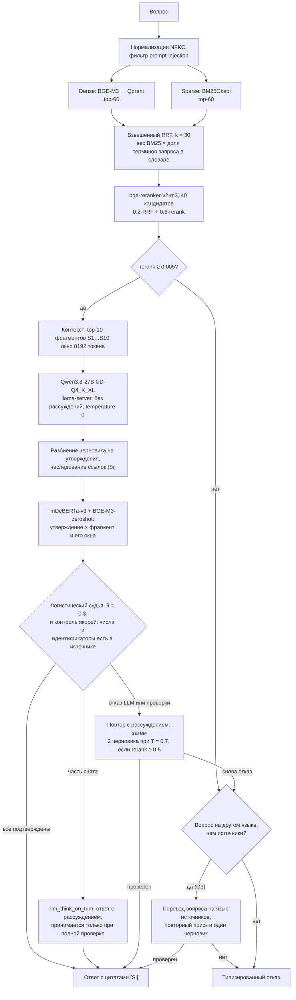
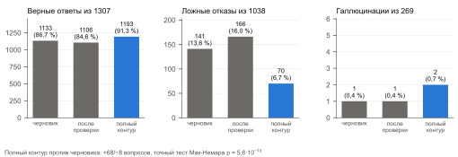
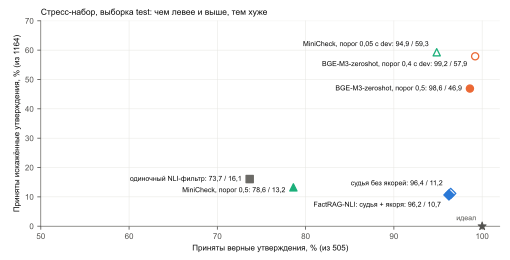
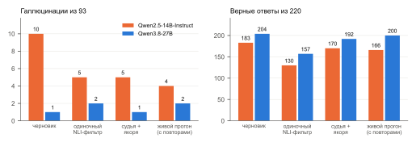

# FactRAG-NLI

[](https://github.com/EGRNEGR/FactRAG-NLI/actions/workflows/tests.yml)


**Локальная RAG-система для технической документации, которая не публикует утверждения LLM без подтверждения источником.**
Ответ со ссылками на источники генерирует Qwen3.8-27B, затем каждое утверждение проверяет логистический судья над двумя NLI-моделями (mDeBERTa-v3 и BGE-M3-zeroshot) с детерминированным контролем чисел и идентификаторов. Неподтверждённое удаляется, а после отказа контур делает повторные проходы и публикует их результат, только если он проверен полностью. Весь конвейер работает на одной RTX 3090 без внешних API.

**Итог (прогон `20261104T1222Z`, 1307 вопросов: технический набор v3 и XQuAD):** 91,3 % верных ответов против 86,7 % у черновика того же генератора (+68/−8 вопросов, точный тест Мак-Немара p = 5,6·10⁻¹³), галлюцинации 0,7 % (2 из 269), ложные отказы 6,7 %, медиана полного ответа 4,4–6,1 с.

- [Как это работает](#как-это-работает)
- [Ключевые возможности](#ключевые-возможности)
- [Результаты](#результаты)
- [Быстрый старт (RTX 3090, Linux)](#быстрый-старт-rtx-3090-linux)
- [Конфигурация](#конфигурация)
- [Структура репозитория](#структура-репозитория)
- [Ограничения](#ограничения)
- [История: прототип на GPU 8 ГБ](#история-прототип-на-gpu-8-гб)

## Как это работает



Посылкой для NLI служит процитированный фрагмент без служебного заголовка и его окна из 1–2 предложений, дополненные названием документа и раздела. Судья объединяет вероятности следования и противоречия обеих моделей (`data/nli_judge/bge-m3-zeroshot.json`, порог подобран на выборке dev). Контроль якорей работает как жёсткое правило: утверждение с числом, кодом или идентификатором, которого нет в источнике, не публикуется при любой оценке моделей. Структурный разбор parser v2 читает подписи таблиц, сеточные таблицы RFC и заголовки разделов. Подробности по этапам: [optimization_3](reports/optimization_3/FINAL_REPORT.md) (судья, think_on_trim), [optimization_4](reports/optimization_4/FINAL_REPORT.md) (G3), [optimization_5](reports/optimization_5/FINAL_REPORT.md) (parser v2).

## Ключевые возможности

- **Полностью локальный контур.** Модели загружаются только из локальных файлов (`local_files_only`, `trust_remote_code=False`), LLM доступна только по loopback; документы и вопросы не покидают машину.
- **Двухэтапный гибридный поиск.** Dense-векторы BGE-M3 находят перефразировки, BM25 — точные термины, коды и идентификаторы. RRF объединяет кандидатов, а вес BM25 зависит от того, какая доля терминов запроса есть в словаре индекса. Переранжировщик bge-reranker-v2-m3 и гейт релевантности отсекают вопросы вне базы до вызова LLM.
- **Двухмодельная проверка каждого утверждения.** Логистический судья над mDeBERTa-v3 и BGE-M3-zeroshot плюс детерминированный контроль якорей; проверка двумя моделями занимает 0,1–0,2 с на ответ.
- **Восстановление полноты без ослабления проверки.** Рассуждение после отказа и после частичного удаления утверждений, сэмплирование при сильном источнике, перевод вопроса на язык документов (G3). Любой повторный проход публикуется только в полностью проверенном виде.
- **Воспроизводимая оценка.** Замороженное разбиение dev/test (651 / 656 вопросов), пороги подбираются только на dev, точный тест Мак-Немара по каждому вопросу, хеши датасета, кода и весов в каждом прогоне, офлайн-replay сохранённых черновиков без LLM.
- **Документы PDF, DOCX, TXT, Markdown** со структурой разделов и таблиц, инкрементальная загрузка с дедупликацией по SHA-256; интерфейсы Streamlit, FastAPI и CLI.

## Результаты

### Сквозная точность по этапам оптимизации

Полные прогоны на RTX 3090, 1307 вопросов (v3 — 220 технических вопросов по RFC 9110, 9000, 9457, 9562, NIST SP 800-63B-4 и 800-53 Rev. 5, PostgreSQL 18 и PEP 703; XQuAD — 1087 вопросов на русском и английском по параллельному корпусу). «Черновик» — первый ответ того же генератора без проверки.

| Метрика | `0749Z` исходная | `1310Z` якоря, think_on_trim | `1929Z` + G3 | `1222Z` + parser v2 |
|---|---|---|---|---|
| Верно, все 1307 | 90,2 % (1179) | 90,6 % (1184) | 90,9 % (1188) | **91,3 % (1193)** |
| Верно, v3 (220) | 86,4 % (190) | 88,6 % (195) | 88,6 % (195) | **90,9 % (200)** |
| Верно, XQuAD (1087) | 91,0 % (989) | 91,0 % (989) | 91,4 % (993) | 91,4 % (993) |
| Черновик без проверки, все | 86,0 % (1124) | 86,0 % (1124) | 86,1 % (1125) | 86,7 % (1133) |
| Галлюцинации (из 269) | 1,1 % (3) | 1,1 % (3) | 1,1 % (3) | **0,7 % (2)** |
| Ложные отказы (из 1038) | 7,6 % (79) | 7,6 % (79) | 7,1 % (74) | **6,7 % (70)** |
| Попарно к предыдущему | — | +5/−0, p = 0,0625 | +4/−0, p = 0,125 | +11/−6, p = 0,33 |
| Попарно к черновику | +67/−12 | +68/−8 | +70/−7 | **+68/−8, p = 5,6·10⁻¹³** |

Суммарный эффект оптимизации (`1222Z` против `0749Z`) — +18/−4 вопроса, p = 0,0043, поровну на dev (+9/−2) и test (+9/−2). Отдельные шаги значимости не достигают и не могут её достичь: при +4/−0 наименьшее возможное p равно 0,125. Поэтому критерием их принятия служили ноль новых галлюцинаций, ноль потерь ранее верных ответов и одинаковый прирост на dev и test.

### Что даёт проверка, а что — повторные проходы



Проверка сама по себе точность не повышает. На тех же черновиках она снимает 27 верных ответов (+0/−27) и переводит их в отказы. Выше черновика контур поднимают повторные проходы: +88/−1 к проверенному черновику, итог +68/−8 к исходному. Число галлюцинаций на финальном генераторе мало при любом методе (1–2 из 269), поэтому безопасность методов проверки сравнивается на стресс-наборе. Данные: [`reports/review/significance.json`](reports/review/significance.json).

### Сравнение с внешними методами проверки



Стресс-набор построен из первых черновиков `1222Z`. Он содержит 505 верных утверждений выборки test и 1164 искажённых четырёх видов: подмена числа, вставка или снятие отрицания, подмена ответа и утверждение из другого документа.

| Метод проверки | Верные, % | Все искажения, % | Подмена числа, % | Отрицание, % | Подмена ответа, % |
|---|---|---|---|---|---|
| одиночный NLI-фильтр (mDeBERTa-v3, весь фрагмент) | 73,7 | 16,1 | 5,5 | 9,3 | 25,3 |
| BGE-M3-zeroshot, порог 0,5 | 98,6 | 46,9 | 45,9 | 66,5 | 61,9 |
| MiniCheck-Flan-T5-Large, порог 0,5 | 78,6 | 13,2 | 9,4 | 1,6 | 46,0 |
| MiniCheck-Flan-T5-Large, порог 0,05 (dev) | 94,9 | 59,3 | 69,1 | 70,2 | 95,2 |
| **FactRAG-NLI: судья + якоря** | **96,2** | **10,7** | **5,0** | 12,9 | 26,6 |

MiniCheck слаб на предметной области, а не на языке: на англоязычных вопросах к документам v3 он сохраняет 50,8 % верных утверждений, судья во всех четырёх языковых парах — 90,9–97,5 %. Общее слабое место всех методов — подмена ответа другой сущностью того же абзаца. Код и данные: [`research/review`](research/review), [`reports/review`](reports/review).

### Второй генератор



На черновиках Qwen2.5-14B-Instruct (набор v3) судья снимает 5 галлюцинаций из 10 и не добавляет новых, теряя 18 верных ответов; одиночный NLI-фильтр снимает те же пять ценой 58. Направление эффекта одинаково на обоих генераторах, но при +5/−0 точный тест даёт p = 0,0625, поэтому вывод остаётся качественным ([`second_generator.json`](reports/review/second_generator.json)).

### Поиск, время и разметка

- **Поиск:** XQuAD — Recall@5 0,981, MRR@10 0,966, гейт отклоняет 81,8 % неотвечаемых вопросов и 1,4 % отвечаемых; v3 — parser v2 поднял Recall@5 с 0,837 до 0,907 и MRR@10 с 0,769 до 0,824.
- **Время на RTX 3090:** медиана полного ответа 6,1 с на v3 и 4,4 с на XQuAD; генерация занимает 89–91 % времени, поиск, переранжирование и проверка вместе — меньше 0,5 с. Пиковая видеопамять — до 21,9 ГБ из 24, полный прогон 1307 вопросов идёт около трёх часов.
- **Разметка v3:** все 220 вопросов проверены вручную, согласие автоматического оценщика с экспертом 217 из 220, κ Коэна = 0,912 ([`reports/review/audit`](reports/review/audit)).

Графики строит `python scripts/readme_figures.py` из файлов `reports/review/*.json`.

## Быстрый старт (RTX 3090, Linux)

Проверено на Ubuntu 24.04 с RTX 3090 (24 ГБ, sm_86), llama.cpp b12002 (`ubuntu-cuda-12.8-x64`). Полное руководство: [`docs/RTX3090_LINUX.md`](docs/RTX3090_LINUX.md).

```bash
git clone https://github.com/EGRNEGR/FactRAG-NLI.git
cd FactRAG-NLI
bash scripts/linux/setup.sh                        # venv, PyTorch, llama.cpp, модели (~34 ГБ), .env, тесты
bash scripts/linux/llama_server.sh start           # профиль qwen38-27b-hybrid; status | stop | restart
PLAN=quick bash scripts/linux/run_benchmark.sh     # 10 вопросов на датасет, ~15 мин
PLAN=main bash scripts/linux/run_benchmark.sh      # итоговая конфигурация на 1307 вопросах, ~3,5 ч
bash scripts/linux/run_benchmark.sh --resume       # продолжить после остановки или перезагрузки
bash scripts/linux/stop_benchmark.sh               # остановить прогон и llama-server
```

Копия без git обновляется из ветки `main` командой `UPDATE_BRANCH=main bash scripts/linux/update.sh`. Модели, `.venv`, `.env` и результаты прогонов при обновлении не затрагиваются. Отдельные механизмы отключаются переменными `THINK_RETRY=off`, `THINK_ON_TRIM=false`, `RECOVERY=off`, `QUERY_TRANSLATION=off`, `PARSER=v1`, а `VERIFIER=rules` возвращает верификатор v2 на правилах.

Модульные тесты не требуют весов моделей и GPU:

```bash
python -m pytest
python -m ruff check .
python -m mypy --strict .
```

## Конфигурация

Итоговый профиль — [`.env.rtx3090.example`](.env.rtx3090.example) и `scripts/linux/env.rtx3090.sh` (профиль `qwen38-27b-hybrid`); полный список параметров `RAG_*` — в [`settings.py`](settings.py).

| Параметр | Значение | Назначение |
|---|---|---|
| `RAG_LLM_MODEL_PATH` | `Qwen3.8-27B-UD-Q4_K_XL.gguf` | Генератор, все слои на GPU, окно `RAG_LLM_CONTEXT_WINDOW=8192` |
| `RAG_LLM_DISABLE_THINKING`, `RAG_LLM_THINK_RETRY`, `RAG_LLM_THINK_ON_TRIM` | `true`, `refusal`, `true` | Ответ без рассуждений; рассуждение только после отказа или частичного удаления утверждений |
| `RAG_LLM_RECOVERY`, `RAG_LLM_RECOVERY_MIN_RERANK` | `sampling`, `0.5` | Два черновика при T = 0.7 после отказа, если лучший источник сильный |
| `LLM_QUERY_TRANSLATION` (env.rtx3090.sh) | `refusal` | G3: перевод вопроса на язык источников после отказа |
| `RAG_PARSER_VERSION` | `v2` | Структурный разбор таблиц и заголовков |
| `RAG_RERANKER_MODEL_PATH` | `models/bge-reranker-v2-m3` | Переранжировщик |
| `RAG_RRF_K`, `RAG_RERANK_CANDIDATES`, `RAG_RERANK_RRF_ALPHA` | `30`, `40`, `0.2` | RRF и смешение с оценкой реранкера |
| `RAG_RERANK_SCORE_THRESHOLD`, `RAG_RERANK_TOP_K` | `0.005`, `10` | Гейт релевантности и число фрагментов в контексте |
| `RAG_NLI_DECISION`, `RAG_NLI_SECONDARY_MODEL_PATH` | `judge`, `models/nli-bge-m3-zeroshot` | Логистический судья над двумя NLI-моделями |
| `RAG_NLI_JUDGE_PATH` | `data/nli_judge/bge-m3-zeroshot.json` | Коэффициенты и порог судьи (подобраны на dev) |
| `RAG_NLI_ANCHOR_GUARD` | `true` | Числа и идентификаторы утверждения обязаны быть в источнике |
| `RAG_NLI_WINDOW_SENTENCES`, `RAG_NLI_PREMISE_TITLE` | `2`, `true` | Окна посылки и префикс «Название документа. Раздел.» |
| `RAG_EMBEDDING_DEVICE`, `RAG_MODEL_DEVICE` | `cpu`, `cuda` | BGE-M3 на CPU освобождает около 1 ГБ видеопамяти |
| `RAG_GENERATION_LANGUAGE` | `ru` | Язык ответа |

## Структура репозитория

```text
FactRAG-NLI/
├── settings.py              # типизированная конфигурация RAG_*, проверки профиля
├── document_parser.py       # PDF/DOCX/TXT/MD → структурные чанки (parser v1 / v2)
├── document_processor.py    # инкрементальная загрузка, SHA-256-дедупликация
├── hybrid_retriever.py      # BGE-M3 + Qdrant, BM25, RRF, cross-encoder, гейт релевантности
├── generator_verifier.py    # промпт, LLM, NLI-проверка (окна, якоря, судья, агрегация)
├── grounding.py             # сегментация, наследование ссылок, окна, якоря
├── pipeline.py              # оркестрация: черновик, проверка, повторные проходы, G3
├── query_translation.py     # перевод вопроса на язык источников после отказа
├── app.py, api.py, demo.py  # Streamlit, FastAPI, CLI
├── evaluate_suite.py        # оценка: поиск, NLI, сквозной прогон, replay верификатора
├── data/
│   ├── eval_dataset_v3.json # 220 технических вопросов с gold_context
│   ├── xquad_dataset_full.json  # 1087 вопросов XQuAD в схеме v3
│   ├── nli_judge/           # коэффициенты логистического судьи
│   └── test_docs/           # корпус v3
├── research/                # офлайн-эксперименты: opt2…optimization_6, review (рецензия)
├── reports/
│   ├── optimization_3 … optimization_6/  # гипотезы, эксперименты, FINAL_REPORT.md
│   ├── review/              # внешние верификаторы, стресс-набор, второй генератор, аудит v3
│   ├── figures/             # графики README и отчётов
│   ├── runs/                # конфигурация и логи прогонов
│   └── EVALUATION_REPORT.md # отчёт по прототипу
├── scripts/linux/           # установка, llama-server, прогоны с отдыхом GPU, обновление
├── scripts/                 # сборка датасетов, рендер отчётов, графики README
├── tests/                   # модульные тесты (без весов моделей)
└── docs/                    # руководства: RTX 3090, эксплуатация, релиз
```

## Ограничения

- Проверка утверждений сама по себе переводит ошибки из галлюцинаций в отказы, а не повышает точность; прирост над черновиком создают повторные проходы (см. [Результаты](#что-даёт-проверка-а-что--повторные-проходы)).
- Подмену ответа другой сущностью того же абзаца не распознаёт ни один из проверенных методов: судья пропускает 26,6 % таких утверждений, потому что новая сущность есть в источнике. Остаются трудными модальные конструкции (MUST / SHOULD), отрицания и привязка значения к нужной строке таблицы.
- Гейт релевантности на v3 не отсекает неотвечаемые вопросы: они относятся к тем же документам (смежный раздел, ложная предпосылка, другая версия стандарта). Их удерживают отказ генератора и верификатор.
- Разметку v3 вручную проверил один эксперт; независимая перекрёстная разметка не проводилась. Полный прогон контура выполнен с одним генератором, второй (Qwen2.5-14B-Instruct) проверен только на сохранённых черновиках.
- Вердикт верификатора не гарантирует фактической точности: NLI-модели ошибаются в обе стороны.
- Сканированные PDF без текстового слоя (OCR) и формат `.doc` не поддерживаются. Интерфейс рассчитан на доверенную локальную машину: многопользовательской авторизации в Web нет.

## История: прототип на GPU 8 ГБ

Первая версия работала на RTX 5060 Laptop (8 ГБ, Windows) с Qwen2.5-14B-Instruct Q4_K_M, bge-reranker-large и одиночным mDeBERTa-v3 и давала на наборе v3 75,5 % верных ответов при медиане ответа 21,4 с. Итоговая конфигурация на том же наборе даёт 90,9 % при 6,1 с. Сравнение отражает совокупную смену генератора, переранжировщика, верификатора и оборудования, а не вклад отдельных компонентов.

<details>
<summary>Результаты прототипа (набор v3, 220 вопросов)</summary>

Сквозной прогон на 220 вопросах датасета v3, прод-профиль. *Standard RAG* - первый черновик той же LLM до NLI-фильтра (тот же поиск, порог релевантности и промпт), поэтому сравнение парное; после отказа NLI FactRAG-NLI один раз повторяет генерацию с отклонёнными утверждениями.

| Метрика | Standard RAG (без NLI) | FactRAG-NLI, верификатор v2 (те же черновики) | FactRAG-NLI, верификатор v1 | FactRAG-NLI, базовый прогон `20261026T1410Z_v3` |
| :--- | ---: | ---: | ---: | ---: |
| Корректный исход, все вопросы ↑ | 83.2 % (183/220; ДИ 78-88 %) | 78.6 % (173/220; ДИ 73-84 %) | 75.5 % (166/220; ДИ 69-81 %) | 56.8 % (125/220; ДИ 50-63 %) |
| Ключевые факты верны (отвечаемые) ↑ | 78.7 % (100/127; ДИ 71-85 %) | 66.9 % (85/127; ДИ 58-75 %) | 60.6 % (77/127; ДИ 52-69 %) | 27.6 % (35/127; ДИ 21-36 %) |
| Отказы на отвечаемых вопросах ↓ | 7.9 % (10/127; ДИ 4-14 %) | 18.1 % (23/127; ДИ 12-26 %) | 18.9 % (24/127; ДИ 13-27 %) | 47.2 % (60/127; ДИ 39-56 %) |
| Галлюцинации на вопросах с известной истиной ↓ | 10.8 % (10/93; ДИ 6-19 %) | 5.4 % (5/93; ДИ 2-12 %) | 4.3 % (4/93; ДИ 2-11 %) | 3.2 % (3/93; ДИ 1-9 %) |
| Галлюцинации, внесённые NLI-фильтром ↓ | - | 0 | 0 | 2 |

Столбец «верификатор v2» - текущий верификатор (название документа в посылке и совместная проверка), применённый без LLM к сохранённым первым черновикам этого же прогона (`reports/runs/20261027T0447Z_v3_verifier2`); столбец «верификатор v1» измерен в живом прогоне с повторной генерацией после отказа NLI.

NLI-фильтр снижает долю корректных исходов относительно черновика (только Standard RAG верен в 23 кейсах, только FactRAG-NLI в 6; точный тест Мак-Немара p = 0.002) и уменьшает число галлюцинаций с 10 до 4 из 93. Что изменено по сравнению с базовым прогоном и вклад каждого изменения: [раздел 2 отчёта](reports/EVALUATION_REPORT.md#2-что-изменено-и-почему); разбор оставшихся ошибок: [раздел 5](reports/EVALUATION_REPORT.md#5-разбор-ошибок). NLI-верификация добавляет p50 390 мс к запросу; основное время занимает генерация LLM (p50 20 547 мс).

NLI-модуль на 440 контрольных парах EN/RU: перехват 87.6 %, ложная отбраковка 3.5 % (базовый прогон: 88.2 % и 25.2 %); верификатор v2: перехват 86.0 %, ложная отбраковка 2.4 %.

Поиск, Recall@5: dense 0.767, BM25 0.645, RRF 0.762, RRF + реранкинг 0.820 (базовый прогон: 0.799).

Полный отчёт с методикой, абляциями, разбором ошибок и таймингами: [`reports/EVALUATION_REPORT.md`](reports/EVALUATION_REPORT.md); сводные таблицы: [`reports/tables/`](reports/tables/); сырые логи прогона: [`reports/runs/`](reports/runs/).

Стенд: RTX 5060 Laptop 8 ГБ, Qwen2.5-14B-Instruct Q4_K_M (llama.cpp, `-ngl 25`), корпус из 9 открытых документов (RFC 9110, RFC 9000, RFC 9457, RFC 9562, NIST SP 800-63B-4, NIST SP 800-53 Rev. 5, PostgreSQL 18, PEP 703), вопросы на русском и английском. Разметка датасета подготовлена ИИ и проверена механически (дословные цитаты, отсутствие терминов в корпусе), экспертной проверки не было.

</details>

<details>
<summary>Запуск и конфигурация прототипа (Windows, GPU 8 ГБ)</summary>

Проверено на Windows 11, Python 3.12, NVIDIA RTX 5060 Laptop (sm_120).

#### 1. Окружение

```powershell
git clone https://github.com/EGRNEGR/FactRAG-NLI.git
cd FactRAG-NLI
py -3.12 -m venv .venv
.\.venv\Scripts\Activate.ps1
python -m pip install -r requirements.txt
python -m pip install "transformers>=4.40" httpx==0.28.1
```

PyTorch с CUDA устанавливается отдельно; для RTX 50xx нужна сборка с поддержкой sm_120 (проверено: `2.12.0.dev20260408+cu128`, см. [`docs/evidence/release_runtime.txt`](docs/evidence/release_runtime.txt)). Проверка реального вычисления на GPU:

```powershell
python -c "import torch; x=torch.randn(64,64,device='cuda'); print(torch.__version__, (x@x).shape)"
```

#### 2. Веса моделей

| Каталог | Источник |
|---|---|
| `models/bge-m3` | [BAAI/bge-m3](https://huggingface.co/BAAI/bge-m3) |
| `models/bge-reranker-large` | [BAAI/bge-reranker-large](https://huggingface.co/BAAI/bge-reranker-large) |
| `models/mdeberta-nli` | [MoritzLaurer/mDeBERTa-v3-base-xnli-multilingual-nli-2mil7](https://huggingface.co/MoritzLaurer/mDeBERTa-v3-base-xnli-multilingual-nli-2mil7) |
| `models/llm/Qwen2.5-14B-Instruct-Q4_K_M.gguf` | [Qwen/Qwen2.5-14B-Instruct-GGUF](https://huggingface.co/Qwen/Qwen2.5-14B-Instruct-GGUF) |

`llama-server.exe` и его DLL из [релиза llama.cpp](https://github.com/ggml-org/llama.cpp/releases) помещаются в `tools/llama/`. Веса и бинарники в репозиторий не входят; порядок доставки и сверки хешей описан в [`docs/RELEASE_GUIDE.md`](docs/RELEASE_GUIDE.md). Аудит окружения: `python scripts/verify_environment.py`.

#### 3. Конфигурация

```powershell
Copy-Item .env.example .env
python -c "import json, secrets; print(json.dumps([secrets.token_urlsafe(48)]))"   # значение для RAG_API_TOKENS
```

`.env.example` содержит профиль, на котором получены опубликованные метрики.

#### 4. LLM-сервер

```powershell
.\tools\llama\llama-server.exe -m .\models\llm\Qwen2.5-14B-Instruct-Q4_K_M.gguf -ngl 25 -c 4096 -b 128 -ub 64 -np 1 --cache-ram 0 --port 8080 --host 127.0.0.1
```

`-ngl 25` подобран замером на RTX 5060 Laptop 8 ГБ: рядом с llama-server на GPU работают BGE-M3, реранкер и NLI (около 2.7 ГБ в процессе PyTorch). Прежний профиль `-ngl 35` с llama.cpp сборки 10819 в 8 ГБ вместе с ними не помещается: драйвер Windows вытесняет часть буферов llama-server в общую память, и со второго запроса обработка промпта замедляется примерно в 4 раза; при 25 слоях скорость стабильна. Таблица замеров: [отчёт, раздел 6](reports/EVALUATION_REPORT.md#6-задержки-и-ресурсы). `.\scripts\start_rag.ps1` запускает сервер с тем же профилем; прежний задаётся параметром `-GpuLayers 35`.

`--cache-ram 0` отключает кэш промптов в ОЗУ (в сборке 10819 он по умолчанию до 8 ГиБ): при сотнях разных вопросов он не даёт повторного использования, а рост памяти выталкивает CPU-слои модели из ОЗУ. Флаг поддерживается только новыми сборками llama.cpp.

#### 5. Индексация и запуск

```powershell
python baseline_rag.py --index ./data/documents            # индексировать каталог документов
python scripts/manage_index.py --add "C:\Docs\manual.pdf"  # добавить файл инкрементально
.\scripts\start_rag.ps1                                    # llama-server + Streamlit: http://127.0.0.1:8501
uvicorn api:app --host 127.0.0.1 --port 8000               # или HTTP API: /health, /ingest, /query
python demo.py --query "Что означает код HTTP 204 согласно RFC 9110?" --ensure-index
.\scripts\stop_rag.ps1 -Force                              # остановить llama-server
```

Встроенный Qdrant допускает одного владельца индекса: Web, API, CLI и оценку над одним индексом одновременно не запускают. Подробное руководство по эксплуатации: [`docs/OPERATIONS.md`](docs/OPERATIONS.md).

#### 6. Тесты и оценка

```powershell
python -m pytest                       # модульные тесты без весов моделей и GPU
python -m ruff check .
python -m mypy --strict .

python scripts/build_eval_dataset_v3.py --check                    # проверить датасет v3
python evaluate_suite.py --run-dir reports/runs/my-run retrieval   # абляция поиска (без LLM)
python evaluate_suite.py --run-dir reports/runs/my-run nli         # NLI на контрольных парах
python evaluate_suite.py --run-dir reports/runs/my-run e2e --profile guard_on
python evaluate_suite.py --run-dir reports/runs/my-run e2e --profile guard_off
python evaluate_suite.py --run-dir reports/runs/my-run replay --source reports/runs/<old-run>  # абляция верификатора на сохранённых черновиках (без LLM)
python scripts/render_report.py reports/runs/my-run --baseline reports/runs/<old-run>    # отчёт, таблицы, графики
```

Прогон фиксирует seed, параметры сэмплирования, пороги NLI, хеши датасета, кода и весов, командную строку llama-server и пишет сырые логи по каждому кейсу; прерванный режим продолжается с последнего кейса.

#### Конфигурация прототипа

Все параметры задаются переменными `RAG_*` в `.env` (полный список: [`settings.py`](settings.py)).

| Параметр | Значение | Назначение |
|---|---|---|
| `RAG_MODE`, `RAG_ALLOW_FALLBACK` | `production`, `false` | Без эвристических заглушек моделей |
| `RAG_LLM_API_BASE` | `http://127.0.0.1:8080/v1` | OpenAI-совместимый endpoint llama-server, только loopback |
| `RAG_CHUNK_TARGET_TOKENS`, `RAG_CHUNK_MAX_TOKENS` | `320`, `384` | Нарезка документов (токенизатор BGE-M3) |
| `RAG_DENSE_CANDIDATES`, `RAG_SPARSE_CANDIDATES` | `60`, `60` | Кандидаты dense и BM25 перед RRF |
| `RAG_RRF_K`, `RAG_RERANK_CANDIDATES` | `30`, `40` | Константа RRF и число кандидатов реранкера |
| `RAG_RERANK_RRF_ALPHA` | `0.2` | Доля нормированного RRF в итоговой оценке (остальное - реранкер) |
| `RAG_SPARSE_COVERAGE_WEIGHTING` | `true` | Вес BM25 × доля терминов запроса, найденных в словаре индекса |
| `RAG_RERANK_SCORE_THRESHOLD` | `0.05` | Порог релевантности: ниже него отказ без генерации |
| `RAG_RERANK_TOP_K` | `5` | Источников в контексте LLM |
| `RAG_LLM_CONTEXT_WINDOW`, `RAG_MAX_TOKENS` | `4096`, `512` | Бюджет контекста и ответа |
| `RAG_NLI_ENTAILMENT_THRESHOLD`, `RAG_NLI_STRONG_ENTAILMENT_THRESHOLD` | `0.4`, `0.7` | Подтверждение целым чанком: P(ent) > 0.4 (или ≥ 0.7) |
| `RAG_NLI_CONTRADICTION_THRESHOLD` | `0.2` | P(contradiction), при которой неподтверждённое утверждение получает CONTRADICTION |
| `RAG_NLI_WINDOW_*` | `2` предложения, `0.8` / `0.05` | Окно подтверждает утверждение при P(ent) ≥ 0.8 и P(con) < 0.05 |
| `RAG_NLI_ANCHOR_GUARD`, `RAG_NLI_ANCHOR_WINDOW_*` | `true`, `0.4` / `0.2` | Числа и идентификаторы утверждения обязаны быть в источнике; окно со всеми ними подтверждает при мягких порогах |
| `RAG_NLI_AGGREGATION`, `RAG_NLI_VETO_CONTRADICTION_THRESHOLD` | `support_first`, `0.9` | Одного подтверждающего источника достаточно, если другой не противоречит явно |
| `RAG_CLAIM_SEGMENTATION`, `RAG_CLAIM_CITATION_INHERITANCE` | `v2`, `true` | Сегментация с защитой сокращений, наследование ссылки соседнего предложения |
| `RAG_ABSTENTION_GUARD` | `true` | Оговорки об отсутствии сведений публикуются, исправление предпосылки без обоснования не публикуется |
| `RAG_NLI_PREMISE_TITLE` | `true` | Каждое окно дополнительно оценивается с префиксом «Название документа. Раздел.» |
| `RAG_NLI_CO_VERIFICATION`, `RAG_NLI_CO_VERIFICATION_OVERLAP` | `true`, `0.5` | Совместная проверка утверждений одного источника |
| `RAG_NLI_PRECISION`, `RAG_NLI_BATCH_SIZE` | `float16`, `16` | Точность и размер пакета NLI |
| `RAG_GENERATION_REPAIR_ATTEMPTS` | `1` | Повторная генерация после отказа NLI |
| `RAG_GENERATION_LANGUAGE` | `ru` | Язык ответа |
| `RAG_EMBEDDING_BATCH_SIZE`, `RAG_RERANK_BATCH_SIZE` | `2`, `2` | Батчи, при которых процесс PyTorch укладывается в ~3 ГБ рядом с llama-server |

</details>

## Документация

- [`docs/RTX3090_LINUX.md`](docs/RTX3090_LINUX.md): итоговая конфигурация на RTX 3090, выбор LLM, XQuAD, прогоны
- [`reports/optimization_3`](reports/optimization_3) … [`reports/optimization_6`](reports/optimization_6): ход оптимизации, гипотезы и критерии принятия
- [`reports/review`](reports/review): сравнение с внешними верификаторами, стресс-набор, второй генератор, аудит разметки
- [`docs/OPERATIONS.md`](docs/OPERATIONS.md): эксплуатация (Web, CLI, загрузка, саммаризация, холодный старт)
- [`docs/RELEASE_GUIDE.md`](docs/RELEASE_GUIDE.md): развёртывание и доставка весов
- [`reports/EVALUATION_REPORT.md`](reports/EVALUATION_REPORT.md): оценка прототипа на наборе v3

## Лицензия

Код распространяется по лицензии [BSD 3-Clause](LICENSE). Веса моделей и документы корпуса распространяются по лицензиям их правообладателей.
